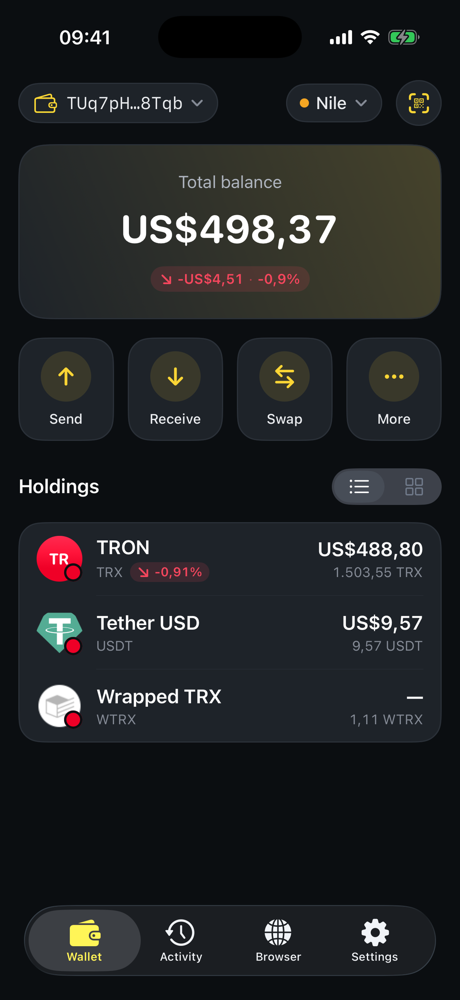

# Introduction

**SaveWallet** is the official wallet developed by **Tronsave**, built for fast, secure, and low‑cost asset management on the **TRON** network.

It is **self‑custodial**: your recovery phrase and private keys are generated and stored **only on your device**. There are no accounts, no sign‑ups, and no one — not even SaveWallet — can access or move your funds.

<figure><figcaption>
Your portfolio, transfers, and dApps — all in one place
</figcaption></figure>

### What you can do

* Hold and manage **TRX**, **USDT (TRC‑20)**, and any **TRC‑20 / TRC‑10** token
* **Send and receive** in seconds with QR codes and an address book
* **Save up to ~80% on network fees** with automatic Energy optimization
* **Swap** tokens, and explore TRON **dApps** through the built‑in browser
* Trade **resources** (Energy & Bandwidth) to make every transaction cheaper

## Why SaveWallet?


**Smart Fee Saving — the headline feature.** When you send USDT or another TRC‑20 token, SaveWallet checks the live Energy price on the **Tronsave** marketplace and automatically rents Energy instead of burning TRX. The result: **much lower fees**, with nothing extra for you to do.


* 🔒 **Security first** — encrypted on‑device storage, passcode, and Face ID / Touch ID.
* 🪙 **All‑in‑one** — TRX, USDT, TRC‑20 tokens, staking, and resources in one app.
* ⚡ **Cheapest transfers** — automatic Energy purchasing keeps fees as low as possible.
* 📊 **Transparent** — real‑time balances and a complete transaction history.
* 🌍 **Multi‑platform** — a native mobile app **and** a Telegram WebApp.
* 🛠 **Simple, yet powerful** — easy for beginners, complete for advanced users.

## Choose your version

SaveWallet comes in two flavors. They share the same keys model and the same Tronsave fee‑saving engine — pick whichever fits how you work.

<table data-card-size="large" data-view="cards"><thead><tr><th></th><th></th><th data-type="content-ref"></th></tr></thead><tbody><tr><td><strong>📱 SaveWallet App</strong></td><td>Native apps for <strong>iOS</strong> and <strong>Android</strong>. Full wallet management, transfers, swap, staking, resources, a dApp browser, and WalletConnect.</td><td><a href="mobile-app/wallet-management/">mobile-app/wallet-management</a></td></tr><tr><td><strong>💬 SaveWallet Telegram WebApp</strong></td><td>A lightweight wallet that runs right inside <strong>Telegram</strong> — create or import a wallet, send, receive, and connect to dApps. No installation needed.</td><td><a href="telegram-webapp/wallet-setup/">telegram-webapp/wallet-setup</a></td></tr></tbody></table>

### Where to get it

| Platform | How to get it |
| --- | --- |
| **iOS** | Download **SaveWallet** from the **App Store** |
| **Android** | Download **SaveWallet** from **Google Play** |
| **Telegram** | Open the official bot: [@savewalletofficial\_bot](https://t.me/savewalletofficial_bot) |


**New here?** Start with [How to create a wallet](mobile-app/wallet-management/how-to-create-a-wallet.md), then learn [how to receive](mobile-app/transfer-tutorial/how-to-receive-my-assets.md) and [send](mobile-app/transfer-tutorial/how-to-transfer-assets-to-the-wallet.md) your first assets.

