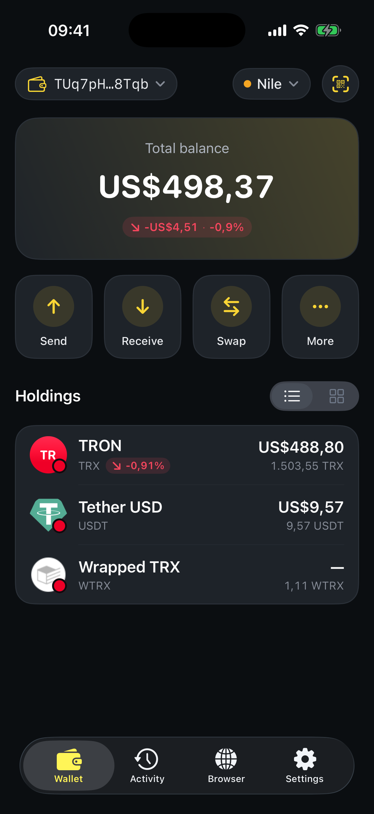

# Custom tokens

A "custom token" is any TRC‑20 asset that isn't widely indexed by explorers like TronScan. In SaveWallet, these are handled the same way as everything else.

## You usually don't need to do anything

Because SaveWallet reads balances directly from the TRON blockchain, **any standard TRC‑20 token you hold is detected and shown automatically** — including newer or less‑common ones. There's no separate "add custom token" step for normal use.

To make a token appear:

1. **Receive it** to your SaveWallet address (see [How to receive assets](../transfer-tutorial/how-to-receive-my-assets.md)).
2. Open the **Home** tab and pull down to refresh.
3. The token appears under **Holdings** with its balance.

<figure><figcaption>
Standard TRC‑20 tokens are detected automatically
</figcaption></figure>


**Beware of scam tokens.** Anyone can create a TRC‑20 token and send it to your address — receiving an unknown token doesn't mean it has value. Never interact with or approve a token you didn't expect, and always verify a token's official contract address before swapping or trading it.



Looking for new projects to interact with? Explore vetted TRON dApps from the [Discover](../savings-discover.md) browser.

