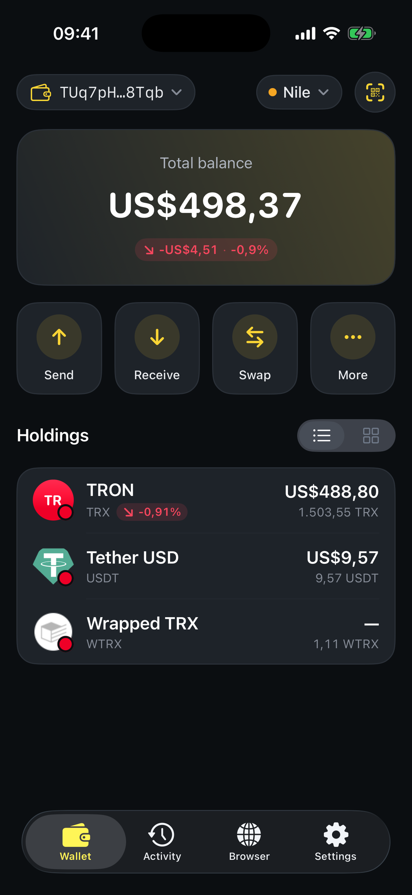

# How tokens appear

In SaveWallet you don't need to add tokens by hand. The app reads your balances directly from the TRON network, so **the tokens you hold appear automatically** on the Home screen.

**Step 1** — Open the **Home** (Wallet) tab. Your TRX balance and any TRC‑20 tokens you own are listed under **Holdings**, with their value and amount.

<figure><figcaption>
Your tokens appear automatically under Holdings
</figcaption></figure>

**Step 2** — Use the **list / grid** toggle next to *Holdings* to change how your assets are displayed.

**Step 3** — Tap any token to open its **details** — price chart, your balance, and quick **Send** / **Receive** / **Swap** actions.


**Just received a token but don't see it?** Give the network a moment and pull down to refresh. Balances are fetched live from TRON; a busy network or a missing API key can slow the first load. You can add free TronGrid / TronScan API keys in **Settings ▸ Network** to load faster.

