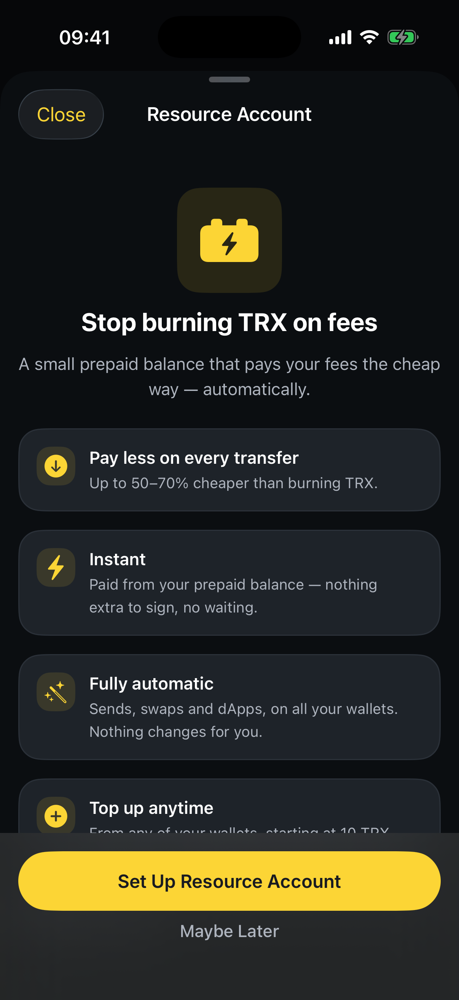
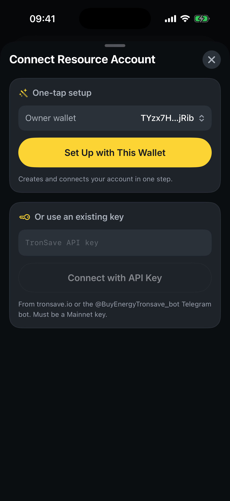
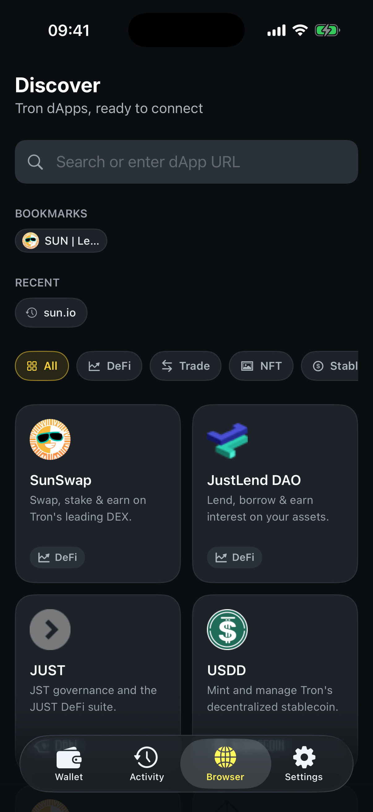

# Savings & Discover

SaveWallet's signature feature is **saving you money on fees** — automatically, on every transaction. Pair that with the built‑in **Discover** browser and you can use TRON dApps while keeping costs low, with nothing extra to configure.

## Automatic fee saving

On TRON, moving TRC‑20 tokens like USDT costs **Energy**. Without it, the network burns your TRX to pay the fee — which is expensive. SaveWallet avoids that:

* Before each transaction, it checks whether you have enough Energy.
* If not, it **automatically rents Energy** from the **Tronsave** marketplace at the best available rate.
* Paying the fee with rented Energy can be **up to ~80% cheaper** than burning TRX.

This is on by default — you can manage it under **Settings ▸ Energy** (the **Auto‑buy energy** toggle).

### Make it even cheaper with a Resource Account

For frequent transfers, set up a **Resource Account** — a small prepaid balance that pays your fees the cheap way, automatically, across all your wallets.

<figure><figcaption>
A prepaid Resource Account makes every transfer cheaper
</figcaption></figure>

To set one up, open **Settings ▸ Energy ▸ Resource Accounts** (or tap the **Pay less on every transfer** banner on the Home screen), then choose **Set Up with This Wallet** for one‑tap setup — or connect an existing **TronSave API key**.

<figure><figcaption>
One‑tap setup, or connect an existing TronSave key
</figcaption></figure>

## Discover — the dApp browser

The **Discover** tab is a built‑in Web3 browser for the TRON ecosystem. Connect to DeFi, swaps, NFTs, and more — directly from your wallet.

**Step 1** — Open the **Browser** (Discover) tab. Browse curated dApps by category (DeFi, Trade, NFT, Stablecoin…) or type a URL in the search bar.

<figure><figcaption>
Curated TRON dApps, ready to connect
</figcaption></figure>

**Step 2** — Open a dApp and **connect your SaveWallet account** when prompted.

**Step 3** — Interact as usual. Any transactions you approve go through SaveWallet's fee‑saving engine, so you benefit from automatic Energy optimization here too.


You can also connect to dApps outside the app using **WalletConnect** — manage active connections and approved token allowances under **Settings ▸ Trusted dApps**, **WalletConnect**, and **Token Approvals**.

