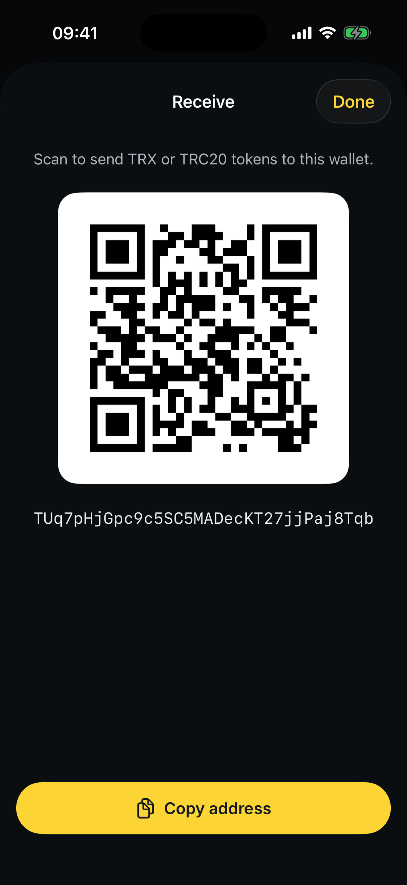

# How to receive assets

To receive TRX or any TRC‑20 token, you simply share your wallet address. The same address works for **all** TRON assets.

**Step 1** — On the Home screen, tap **Receive**.

**Step 2** — Your address and its QR code appear. Tap **Copy address** to copy it, or let the sender **scan the QR code**.

<figure><figcaption>
Share your address or QR code to get paid
</figcaption></figure>

**Step 3** — Paste your address into the withdrawal screen of the exchange or wallet sending you funds. Once the transaction confirms on TRON, your balance updates automatically.


Your TRON address receives **TRX and every TRC‑20 token** — there's no separate address per token. If a token you received doesn't show up right away, see [How tokens appear](../assets-management/how-to-add-a-token.md).

