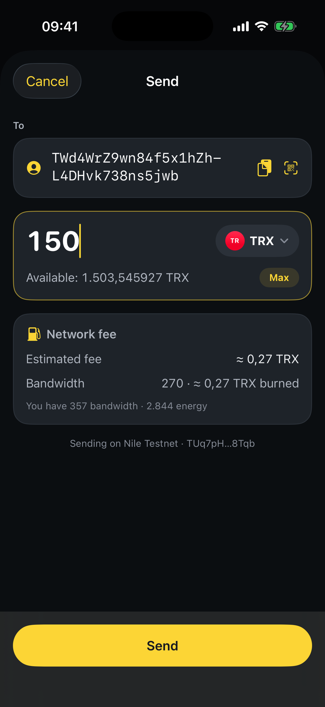

# How to send assets

Send TRX or any TRC‑20 token in a few taps. SaveWallet previews the fee before you confirm, and optimizes it automatically.

**Step 1** — On the Home screen, tap **Send** (or open a token and tap **Send** on its details page).

**Step 2** — Fill in the transfer form:

* **To** — enter the address manually, scan a **QR code**, or tap **Choose from address book** to pick a saved contact.
* **Token** — tap the token selector to choose what you're sending (TRX, USDT, or any token you hold).
* **Amount** — type the amount, or tap **Max** to send your full balance.

<figure><figcaption>
Enter the recipient, choose the token, and set the amount
</figcaption></figure>

**Step 3** — Review the details. SaveWallet shows the estimated **network fee** and the resources used (Bandwidth / Energy).

* For **TRC‑20** tokens, Energy is required to cover fees. If your account is short on Energy, SaveWallet **automatically buys it** at the best market rate to keep your fee low.
* Prefer to pay the standard way? You can opt out by unchecking the energy‑purchase option before confirming.

**Step 4** — Tap **Send** and confirm (with Face ID / Touch ID or your passcode if App Lock is on). Your transaction is broadcast to the TRON network, and you'll see it in **Activity** once it confirms.


**Up to ~80% in fee savings.** SaveWallet automatically rents Energy from the Tronsave marketplace to settle your transaction fee. Paying with Energy instead of burning TRX keeps fees as low as possible while staying fast and reliable. Because of this, you may see an extra **delegate‑energy** transaction alongside your transfer — this is normal. [Read why](../../more/faqs.md).

