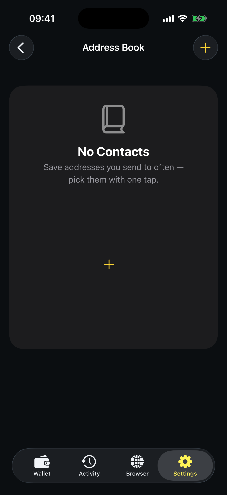
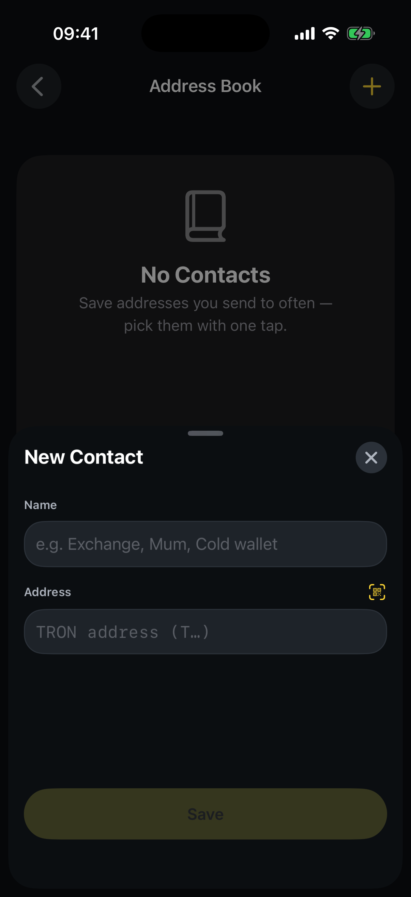
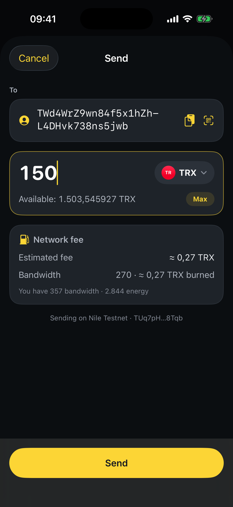

# How to use the Address Book

The Address Book stores the addresses you send to often, so you can pick a saved contact with one tap instead of pasting an address every time — faster, and safer against typos.

## Add a contact

**Step 1** — Go to the **Settings** tab. Under **Wallet**, tap **Address Book**.

<figure><figcaption>
Your saved contacts live here
</figcaption></figure>

**Step 2** — Tap the **+** button (top right) to add a new contact.

**Step 3** — Give the contact a **name**, then paste the TRON **address** (or scan its QR code) and tap **Save**.

<figure><figcaption>
Name your contact and add their TRON address
</figcaption></figure>

## Use a saved contact

When you send, tap **Choose from address book** on the transfer form and pick a saved contact — its address fills in automatically.

<figure><figcaption>
On the Send screen, pick a recipient from your address book
</figcaption></figure>


Always double‑check the first and last few characters of an address before saving or sending. Transactions on TRON are irreversible.

