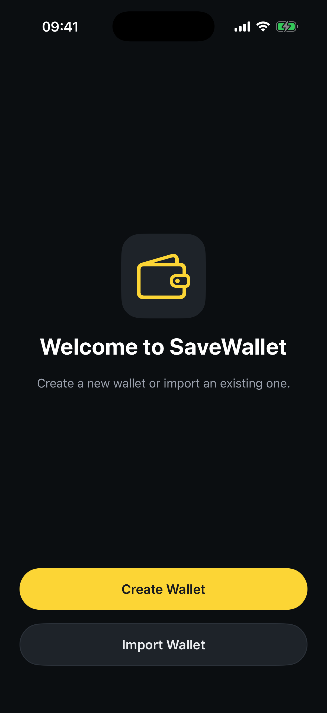
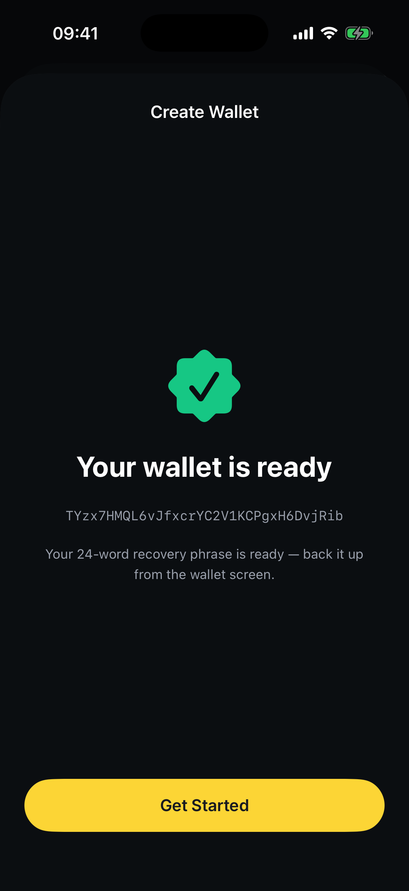
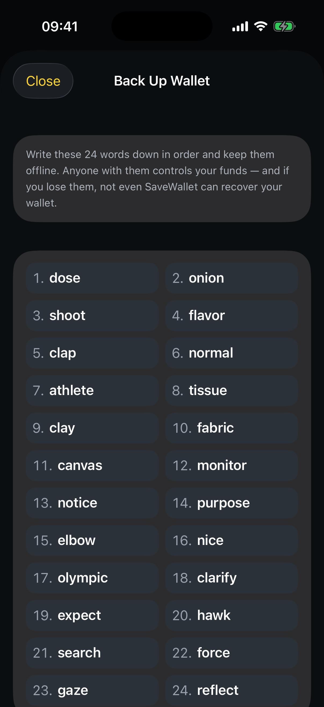
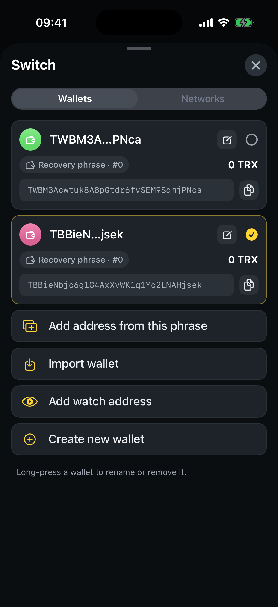

# How to create a wallet

Creating a wallet takes a few seconds and needs no email, phone number, or sign‑up. SaveWallet generates a standard **24‑word recovery phrase** directly on your device — that phrase _is_ your wallet.

## Your first wallet

**Step 1** — Open SaveWallet for the first time and tap **Create Wallet**.

<figure><figcaption>
The welcome screen — choose <strong>Create Wallet</strong>
</figcaption></figure>

**Step 2** — SaveWallet instantly generates your 24‑word recovery phrase and shows your new TRON address. Tap **Get Started** to open your wallet.

<figure><figcaption>
Your wallet is ready — your TRON address is shown here
</figcaption></figure>

## Back up your recovery phrase

For a fast start, backup is **deferred** — your wallet is ready to use immediately, and a **Back up your wallet** reminder stays on the Home screen until you finish.


Do this before you receive any meaningful funds. If you lose your phrase and your device, **nobody can recover your wallet** — not even SaveWallet.


**Step 1** — On the Home screen, tap the **Back up your wallet** banner.

**Step 2** — Write down all **24 words in order** and store them offline. Then tap **Continue**.

<figure><figcaption>
Your 24‑word recovery phrase
</figcaption></figure>

**Step 3** — Confirm a few words to prove you saved them, then tap **Complete Backup**. The reminder disappears once backup is done.

## Add another wallet

Already have a wallet and want one more? You can hold as many as you like.

**Step 1** — On the Home screen, tap the wallet name at the top to open the wallet switcher.

**Step 2** — Tap **Create new wallet**. A new wallet is generated and added to your list.

<figure><figcaption>
Create, import, or watch additional wallets from the switcher
</figcaption></figure>


**Tip:** You can also tap **Add address from this phrase** to derive an extra account from the _same_ recovery phrase — handy for separating funds without managing a new backup.

