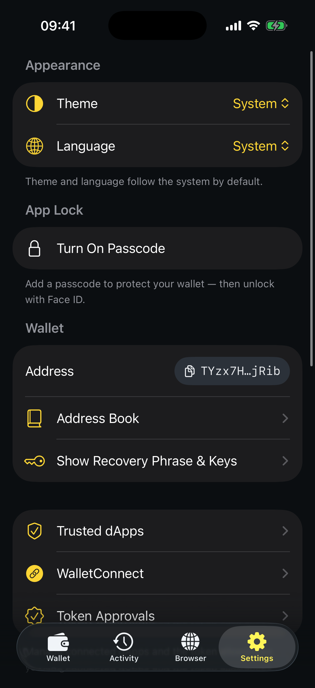
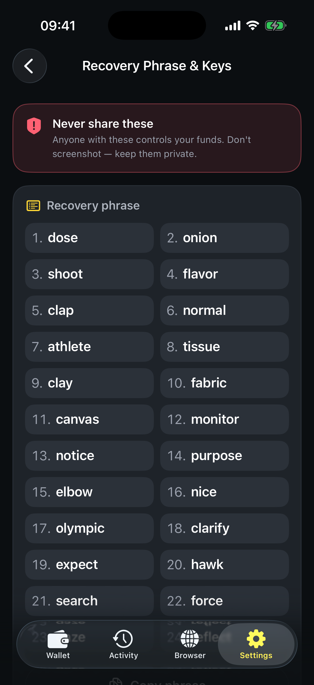
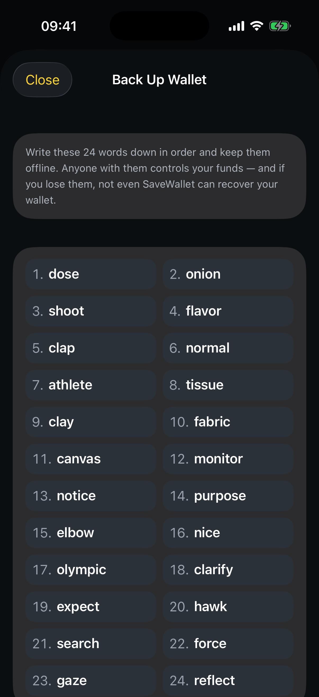

# How to export a wallet

Exporting reveals your **recovery phrase** and **private key** so you can back them up or move your wallet to another app. They live only on your device, and SaveWallet asks you to authenticate before showing them.

**Step 1** — Go to the **Settings** tab. Under **Wallet**, tap **Show Recovery Phrase & Keys**.

<figure><figcaption>
Settings ▸ Wallet ▸ Show Recovery Phrase &#x26; Keys
</figcaption></figure>

**Step 2** — Authenticate with **Face ID / Touch ID** or your **passcode** when prompted.

**Step 3** — Your recovery phrase and private key are shown, each with a **Copy** button.

<figure><figcaption>
Reveal and copy your recovery phrase and private key
</figcaption></figure>


Your private key and recovery phrase are **not encrypted** once revealed. Anyone who has them controls your funds. Keep them offline and private, and never paste them into a website or share them with anyone.


## One‑time backup reminder

Right after you create a wallet, the Home screen shows a **Back up your wallet** banner. Tapping it walks you through writing down your 24 words and verifying them — see [How to create a wallet](how-to-create-a-wallet.md#back-up-your-recovery-phrase). Once done, the reminder disappears, but you can always come back to **Settings ▸ Show Recovery Phrase & Keys** at any time.

<figure><figcaption>
Your 24‑word recovery phrase
</figcaption></figure>
