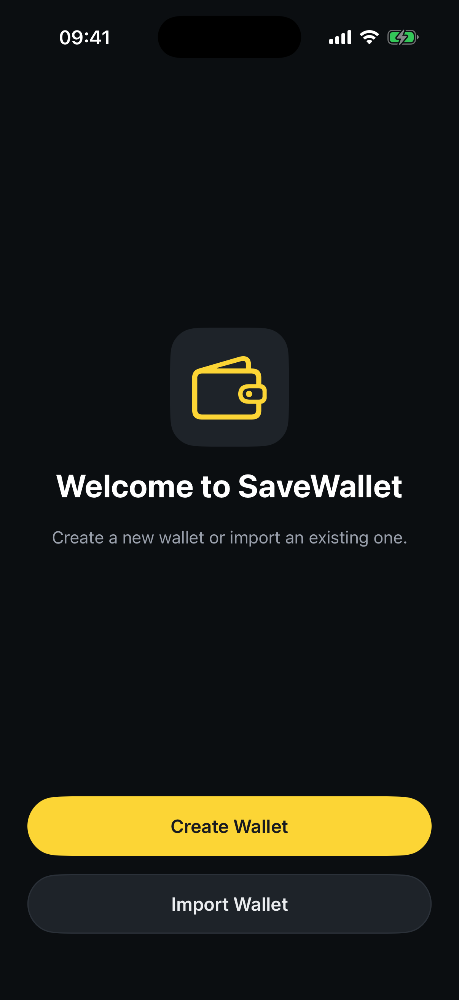
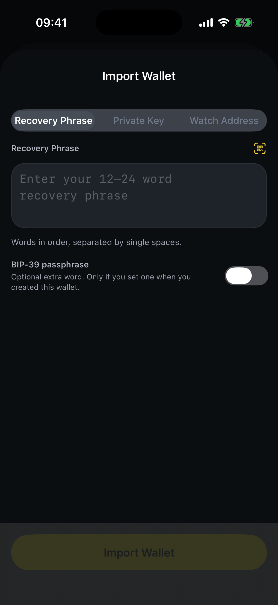
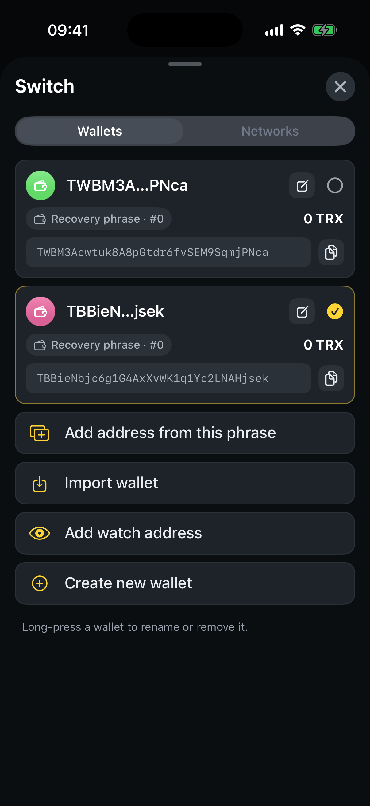

# How to import a wallet

Already have a TRON wallet? Bring it into SaveWallet using its **recovery phrase**, a **private key**, or add any address as **watch‑only**. Everything is validated on your device before it's imported.

## Import as your first wallet

**Step 1** — Open SaveWallet and tap **Import Wallet** on the welcome screen.

<figure><figcaption>
Choose <strong>Import Wallet</strong>
</figcaption></figure>

**Step 2** — Pick how you want to import, then enter your details:

* **Recovery Phrase** — type or paste your 12–24 word phrase (words in order, single spaces). Optionally enable a **BIP‑39 passphrase** if you set one.
* **Private Key** — paste your 64‑character private key (with or without `0x`).
* **Watch Address** — enter any `T…` address to track balances without the key.

<figure><figcaption>
Choose Recovery Phrase, Private Key, or Watch Address
</figcaption></figure>

**Step 3** — When the input is valid (you'll see a green check), tap **Import Wallet** to finish.


You can also scan a recovery phrase or private‑key **QR code** with the scan icon in the input field.


## Import into an existing setup

**Step 1** — On the Home screen, tap the wallet name to open the wallet switcher.

**Step 2** — Tap **Import wallet** and follow the same steps above.

<figure><figcaption>
Import an additional wallet from the switcher
</figcaption></figure>


Only enter your recovery phrase or private key inside the SaveWallet app. Never share it with anyone or type it into a website.

