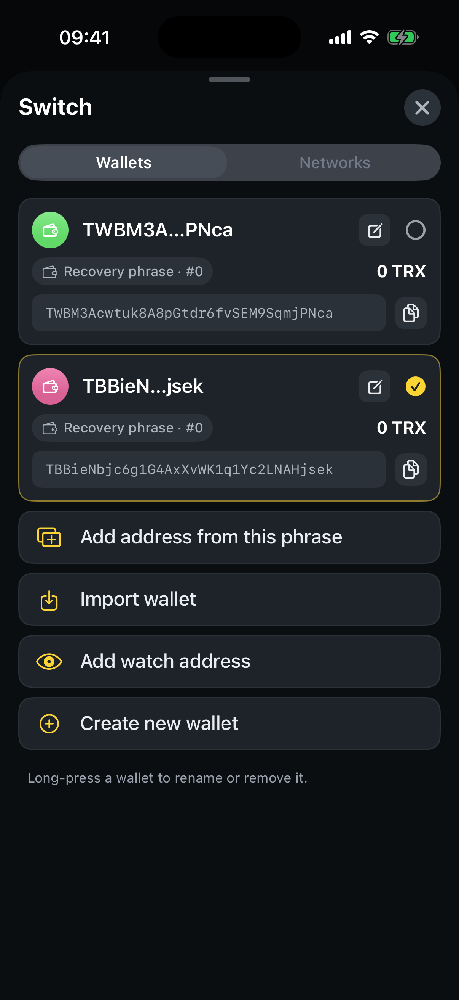

# How to switch wallets

SaveWallet lets you hold multiple wallets and move between them instantly. The active wallet is the one shown on the Home screen.

**Step 1** — On the Home screen, tap the **wallet name** at the top to open the wallet switcher.

**Step 2** — Tap any wallet in the list to make it active. The Home screen updates to that wallet's balances and activity right away.

<figure><figcaption>
Tap a wallet to switch — or add a new one
</figcaption></figure>

From the same screen you can also:

* **Add address from this phrase** — derive another account from your current recovery phrase.
* **Import wallet** — bring in an existing wallet by phrase or private key.
* **Add watch address** — track any TRON address without its key.
* **Create new wallet** — generate a fresh wallet.


**Rename or remove:** long‑press a wallet in the list to rename it or remove it from this device. Removing a wallet does **not** delete it from the blockchain — you can re‑import it later with its recovery phrase or private key.

